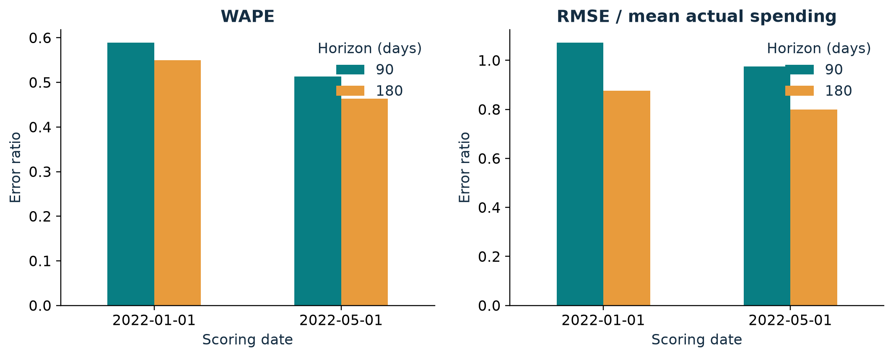
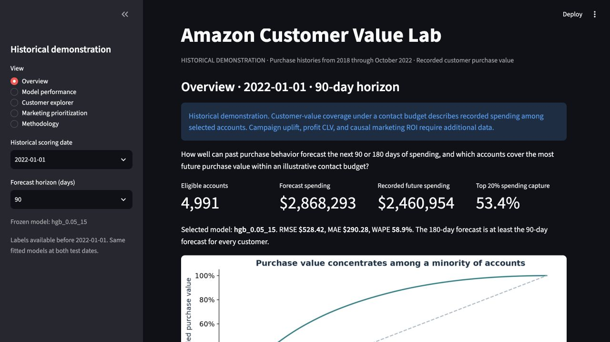

# Amazon Customer Value Prediction and Marketing Prioritization

Predict recorded purchase value over **90 and 180 days** from purchase-only histories, compare horizons on untouched 2022 outcomes, and explore **customer-value coverage under a contact budget**.

This is a historical portfolio using real, consented Open e-commerce 1.0 purchase histories. It does not estimate campaign uplift, incremental revenue, Amazon profit, or lifetime CLV.

## Run the public demo

The repository includes a compact, real-data demo bundle with saved forecasts,
evaluation results, and daily account histories. No raw-data download or model
training is needed to explore it. Use Python 3.12:

```bash
python -m pip install -r requirements.txt
python -m streamlit run dashboard.py
```

On Streamlit Community Cloud, choose this repository, branch `main`, entrypoint
`dashboard.py`, and Python **3.12** under Advanced settings. No secrets are
required. The app automatically uses `demo/` when a local `runs/main/` is absent.
Set `AMAZON_CLV_RUN=demo` to explicitly select the public bundle locally.

Public account IDs are display aliases. The customer explorer shows daily
totals; item titles, product IDs, shipping states, and original survey IDs are
omitted from the demo bundle. Forecasts and aggregate evaluation results are
unchanged. See [demo contents](demo/README.md).

## Findings

The verified original file contains 1,850,717 item rows from 5,027 accounts. Restricting to January 2018–October 2022 retains **1,737,058 rows from 5,015 accounts**. All 113,659 exclusions are later-dated records. Gift cards remain in the main analysis, with an independently trained exclusion sensitivity.

Validation selected **histogram gradient boosting (learning rate .05, 15 leaves)** for 90 days and **Ridge (alpha 100)** for 180 days. Both final models use labels available before January 2022 and stay fixed at both test dates.

| Scoring date | Horizon | MAE | RMSE | WAPE | Top-20% spending capture | Gain vs historical ranking |
|---|---:|---:|---:|---:|---:|---:|
| 2022-01-01 | 90 days | $290.28 | $528.42 | 58.9% | 53.4% | +0.28 pp |
| 2022-05-01 | 90 days | $291.49 | $553.41 | 51.4% | 53.6% | +0.99 pp |
| 2022-01-01 | 180 days | $557.29 | $886.97 | 55.0% | 53.2% | +0.99 pp |
| 2022-05-01 | 180 days | $503.51 | $869.90 | 46.3% | 52.9% | +0.59 pp |

RMSE improves 3.8–6.0% relative to the trailing-year baseline. Ranking gains are modest. **January's 180-day total forecast is 25.3% above actual spending.** The longer horizon has smaller normalized errors, while 90 days has better aggregate calibration.



For the illustrative January 2022 $1,000 budget at $1/contact, the 90-day predicted audience covers **$1,313,621.52** in actual future spending, or **53.38%**, versus **53.22%** for historical ranking. This is spending among selected accounts, not incremental campaign revenue. The 1,000-contact audience and the top-20% metric have slightly different sizes (1,000 vs 999 accounts), so their percentages need not match exactly.

Full evidence, uncertainty intervals, sensitivity, and account examples: [Measured results](docs/RESULTS.md).

## Start here

- [Chronological work and decision log](WORK_LOG.md)
- [Technical interview guide](docs/INTERVIEW_GUIDE.md)
- [10-page report](reports/amazon_customer_value_report.pdf)
- [12-slide editable PowerPoint](reports/amazon_customer_value_presentation.pptx)
- [Data dictionary](docs/DATA_DICTIONARY.md) and [model card](docs/MODEL_CARD.md)
- [Verification record](docs/VERIFICATION.md)

The interview guide includes a 60-second explanation, temporal examples, model and metric explanations, failure cases, engineering tradeoffs, limitations, and practice prompts. Read it alongside measured results instead of memorizing unsupported claims.

## Installation

Tested on macOS ARM64 with Python **3.12.13**, seed **42**. The complete tested dependency closure is pinned in `requirements.lock.txt`. Use a terminal in this project directory:

```bash
python3.12 -m venv .venv
source .venv/bin/activate
python -m pip install -r requirements.lock.txt
python -m pip install --no-build-isolation --no-deps .
python -m pip check
python -m pytest
```

The package installs as a regular wheel. On this machine Python skipped editable-install `.pth` files marked hidden, so the documented regular installation avoids that local issue. After source changes, reinstall with `python -m pip install --no-build-isolation --no-deps --force-reinstall .`. The dashboard integration test skips when real analytical outputs are absent; the contract tests remain self-contained.

The lock records this tested platform. Other operating systems may require platform-compatible wheels for the same Python package versions. The analysis and dashboard use Python only. Rebuilding the PowerPoint additionally uses the Codex-bundled Artifact Tool Node runtime described below.

## Data access and original-file identity

Original dataset: [Harvard Dataverse](https://doi.org/10.7910/DVN/YGLYDY), version 1.0, **CC0 1.0**. Data descriptor: [Berke et al. (2024), Scientific Data](https://www.nature.com/articles/s41597-024-03329-6).

Download `amazon-purchases.csv` from the original release. The supplied file was downloaded earlier from a [Kaggle mirror](https://www.kaggle.com/datasets/dharshinisraghunath/harvard-ecommerce-dataset-for-big-data-analysis) and independently verified byte-for-byte against the original metadata. No new raw dataset was downloaded for this project.

- Bytes: `313070173`
- MD5: `3549d72735b1211ab009ff0177b94bd9`
- SHA256: `6efb098a6e01a9acb6e215402a450f4a848ed1b102ca016f9be6c4f03c585e1e`
- Original metadata snapshot: `provenance/dataverse_metadata.json`

The existing source remains unchanged at:

```text
/Users/Darsh/Documents/Codex/2026-10-18/u/outputs/Amazon_Purchase_Histories_Original.csv
```

The pipeline rejects an unexpected MD5 by default. `--allow-unverified` is an explicit opt-in for deliberate alternate inputs and test fixtures, not a way to claim original provenance.

## Reproduce the analysis

```bash
export AMAZON_CLV_DATA="/absolute/path/to/amazon-purchases.csv"
python -m amazon_clv run --data "$AMAZON_CLV_DATA" --output runs/reproduced
```

The full command audits the source, creates all monthly snapshots, searches the bounded candidates on chronological folds, freezes choices, fits final models, evaluates both 2022 dates, computes 500 customer-cluster bootstrap resamples, repeats the gift sensitivity, and produces publication charts. A completed output directory cannot be overwritten accidentally. The local original run took about three minutes, excluding environment setup and artifact authoring; runtime varies by hardware.

Generate a small explicitly synthetic integration smoke separately:

```bash
python scripts/smoke.py
```

The smoke uses `runs/smoke` and does not support portfolio findings. Choose a new smoke directory in the script before rerunning an already completed smoke.

## Score a saved model

```bash
python -m amazon_clv score \
  --data "$AMAZON_CLV_DATA" \
  --as-of 2022-01-01 \
  --bundle runs/main/bundle \
  --output runs/scored_customers.csv
```

Exports include account ID, scoring date, horizon, predicted value, model/version, and actual value when fully observed. Extra history fields support ranking/exploration. Both commands share `make_snapshot` and `ModelBundle.predict`. Forecasts are nonnegative, and 180-day predictions are at least 90-day predictions. Historical scoring dates from 2019-01-01 through 2022-11-01 are supported. Later scoring requires a new data/coverage contract.

## Launch the dashboard

```bash
python -m streamlit run dashboard.py --server.address 127.0.0.1 --server.port 8501
```

Open [the local dashboard](http://127.0.0.1:8501). It defaults to **January 1, 2022** and reads saved outputs from `runs/main`. To inspect another complete run:

```bash
AMAZON_CLV_RUN=runs/reproduced python -m streamlit run dashboard.py
```



Five views cover overview, performance, customer exploration, budgeted audiences, and methodology. Every view identifies the historical demonstration. [Streamlit caching](https://docs.streamlit.io/develop/concepts/architecture/caching) loads data through `st.cache_data`, with modification stamps for invalidation. The dashboard reads model metadata and saved predictions without loading fitted model binaries. Interactions never retrain. Budget defaults are illustrative $1,000 and $1/contact. Zero and oversized budgets are supported, and invalid budgets/costs reject. Downloads contain the exact displayed selection.

## Notebooks and narrative artifacts

```bash
python scripts/notebooks.py
python scripts/prepare_release.py
python scripts/report.py
```

Each notebook executes from a new kernel and reads saved analytical outputs. They cover data quality, shared features/target construction, validation/test modeling, and marketing analysis. They inspect and verify the fitted results instead of silently changing the model. `AMAZON_CLV_RUN` can point notebooks at another run. Narrative release scripts intentionally use `runs/main` so a published report has one explicit evidence source.

`prepare_release.py` writes the measured results guide and `reports/release_data.json`, the common factual input for report and slides. `report.py` uses ReportLab and the saved charts. `scripts/build_presentation.mjs` uses the available Codex-bundled `@oai/artifact-tool` and skill finalizer; `RUNTIME_NODE_MODULES`, `AMAZON_CLV_PRESENTATION_SKILL`, and `AMAZON_CLV_RUNTIME_PYTHON` identify that additional authoring runtime. It produces editable charts/tables with embedded workbook snapshots, not screenshots. An existing final PPTX is preserved; select a new output filename with `AMAZON_CLV_DECK_FILENAME`. This authoring helper is separate from the standalone Python analytical package.

## Evaluation contract

- Features use transactions strictly before scoring. Targets use `[scoring date, scoring date+horizon)`.
- Eligible accounts with no future purchase remain with zero, while incomplete future windows remain NaN.
- Initial category mapping fits 2018 only. Survey responses and account IDs are excluded from predictors. Frequency means purchase days, not orders.
- Validation dates: January 1 and July 1, 2021. Development scoring dates: 2019–2020. Every training label ends strictly before its validation cutoff.
- Selection: equal-fold mean RMSE; within 1% prefer top-20% capture, then simplicity. ML must improve the best baseline RMSE. HGB runs 300 iterations without internal random early stopping.
- Final fitting: labels ending before January 1, 2022. The same model bundle scores January 1 and May 1, 2022.
- Select 90 first. All 180-day candidates include `max(raw180, selected90)` in validation and testing, matching scoring.
- Metrics: MAE, RMSE, WAPE, normalized RMSE, total/decile calibration, top-10/20% capture, historical-ranking gains, group errors, and gift sensitivity.
- Uncertainty: 500 customer-cluster resamples. Repeated accounts and overlapping windows are dependent. Pooled-window totals can double count purchases and are not unique annual spending.

## Project map

```text
src/amazon_clv/       shared ingestion, features, models, metrics, marketing, CLI
dashboard.py         five-view cached Streamlit application
tests/               temporal, serialization, accounting, export, dashboard checks
notebooks/           four executed explanatory notebooks
scripts/             smoke, notebook execution, evidence, report, deck authoring
docs/                results, data dictionary, model card, interview guide, verification
provenance/          original metadata snapshot
reports/             final PDF, editable PPTX, shared factual release data
runs/main/           ignored full analytical release and sensitivity
WORK_LOG.md          chronological actions, decisions, failures, fixes, outcomes
requirements.lock.txt  complete tested dependency versions
```

Key run outputs: `data_audit.json`, `split_audit.csv`, `frozen_selection.json`, `bundle/models.joblib`, `customer_predictions.csv/.parquet`, `validation_metrics.csv`, `test_metrics.csv`, `calibration.csv`, `bootstrap_intervals.csv`, `segment_errors.csv`, `gift_sensitivity.csv`, `marketing_comparison.csv`, `predictive_associations.csv`, and PNG/PDF charts.

Large data, generated runs, environments, build intermediates, and model binaries are Git-ignored. Code, docs, executed notebooks, a small README chart preview, and final report/deck are ready for repository review. Raw data and full analytical runs are intentionally excluded from the repository. The compact `demo/` bundle supports public hosting. No campaign execution or production monitoring is performed.

## Limitations

Approximately 5,000 consent-selected accounts create a retrospective cohort of established users still active at recruitment. Accounts may be shared and history is left truncated. The common observation end follows the study design but cannot prove complete exports per account. Missing return adjustments, true order IDs, margins, and campaign treatment/outcome data limit interpretation. The gift-title rule is imperfect. These are historical predictions for recorded spending on Amazon, not Amazon revenue/profit or causal marketing effects. Feature importance is predictive association. Future deployment would need prospective evaluation and monitoring.
